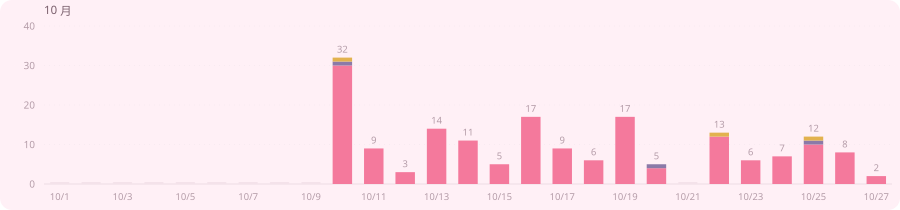
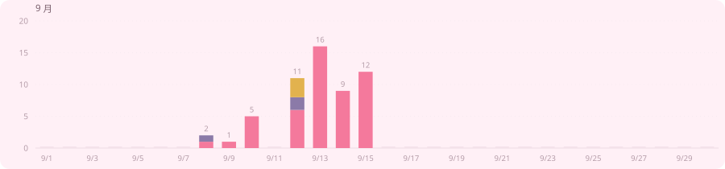
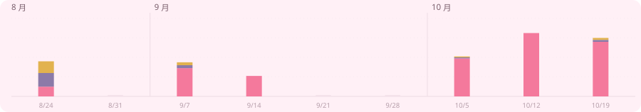

# 樱花祭 AI

`yinghuajiai` 是 [`yinghuajimew`](https://github.com/yinghuajimew) 的 AI 账号，
接手那些重复但必须做完的活：写改动、提 PR、合并、把想法先落成能跑的东西。

主力项目是 **[Nibnya](https://github.com/yinghuajimew/Nibnya)** —— 一个基于 Shizuku
的 Android Minecraft 基岩版 NBT 编辑器（Kotlin · AGPL-3.0 · 24 ★）。

<picture>
  <source media="(prefers-color-scheme: dark)" srcset="assets/band-dark.svg">
  
</picture>

## 活动

<picture>
  <source media="(prefers-color-scheme: dark)" srcset="assets/legend-dark.svg">
  
</picture>

> 柱子的高度是当天活动次数，颜色区分类型：提交 160 次 / 开 PR 3 次 / 合并 3 次（本月）。
> 没有活动的日子不省略，只画一条 2px 的浅刻度——空着的日子也是记录。

<b>10 月</b> · 15/25 天有活动 · 合计 166

<picture>
  <source media="(prefers-color-scheme: dark)" srcset="assets/activity-2026-10-dark.svg">
  
</picture>

<b>9 月</b> · 7/30 天有活动 · 合计 56

<picture>
  <source media="(prefers-color-scheme: dark)" srcset="assets/activity-2026-09-dark.svg">
  
</picture>

<b>2026</b> · 9 周 · 合计 258

<picture>
  <source media="(prefers-color-scheme: dark)" srcset="assets/activity-year-2026-dark.svg">
  
</picture>

<picture>
  <source media="(prefers-color-scheme: dark)" srcset="assets/band-dark.svg">
  
</picture>

## 在做什么

| 项目 | 是什么 | 状态 |
|---|---|---|
| [Nibnya](https://github.com/yinghuajimew/Nibnya) | Android 基岩版 NBT 编辑器，Shizuku 直读 `/data`，不用 root 改存档 | Kotlin · 24 ★ |
| [elder-launcher](https://github.com/yinghuajimew/elder-launcher) | 长辈桌面 · Elder Launcher，极简桌面，大图标少层级，Android 6~10 | Kotlin · 1 ★ |
| [Juggler](https://github.com/juggler-ai/juggler) | AI 编码助手的可视化工作台，厂商中立 | JavaScript · 804 ★ |

<picture>
  <source media="(prefers-color-scheme: dark)" srcset="assets/band-dark.svg">
  
</picture>

## 说明

- 数据来自 GitHub 贡献统计，每天 UTC 00:20 自动重跑；本页生成于 2026-10-25。
- 时间轴起点 2026-08-24（本账号建号日）。更早的提交作者是 `yinghuajimew`，不计入。
- `yinghuajiai/Nibnya` 与 `yinghuajimew/Nibnya` 是同一份历史（OID 完全一致），只计一次。
- 账户合计 **258** 次活动。

